# Feature-ML: полное описание архитектуры, обучения и детектирования

Актуально на 16.10.2026.

## 0. Назначение и правило актуализации

Документ описывает фактическую реализацию feature-ML в текущем состоянии
репозитория: источники данных, псевдоразметку, генерацию кандидатов, признаки,
обучение, runtime и известные ограничения.

При каждом последующем изменении кода feature-ML этот документ должен
обновляться в том же изменении. Если меняются каналы или признаки, одновременно
обновляется и краткая сводка
[`feature-ml-channels-and-features.md`](feature-ml-channels-and-features.md).

`core/lib_info.py` является пользовательским вспомогательным файлом и не входит
в pipeline.

## 1. Что представляет собой текущий алгоритм

Feature-ML — это не нейросеть, обрабатывающая каждую точку сигнала. Это
двухступенчатый **candidate-based detector**:

1. выбранный источник (`posr`, `cpd` или `hybrid`) создаёт raw-кандидаты
   независимо на каждом доступном SXR-канале;
2. токовый gate удаляет заявки до установления тока на плато;
3. близкие оставшиеся заявки разных каналов и методов объединяются;
4. для каждого оставшегося кандидата строится вектор выбранного профиля из 50,
   160 или 224 признаков;
5. табличная модель оценивает вероятность настоящего срыва;
6. применяется порог вероятности и, при запросе, минимум поддержавших SXR;
7. адаптивный NMS оставляет одну наиболее вероятную точку в окрестности,
   размер которой определяется локальным периодом пилы.

Событие, которое не предложил ни один генератор кандидатов, модель восстановить
не может. Поэтому итоговое качество определяется тремя уровнями:

- качеством wavelet-псевдоразметки;
- полнотой POSR/CPD proposals;
- способностью классификатора отделить срывы от ложных заявок.

```mermaid
flowchart LR
    A[SHT] --> B[Подготовка всех каналов]
    B --> C[raw POSR / raw CPD на каждом SXR]
    C --> D[Токовый gate: только после начала плато]
    D --> E[Объединение близких proposals]
    E --> I[Профиль: 50 / 160 / 224 признака]
    I --> F[Табличный классификатор]
    F --> G[Порог и min_channels]
    G --> J[Адаптивный NMS по локальному периоду]
    J --> H[Времена срывов]
```



Алгоритмические детекторы без МО не были переведены на эту схему и продолжают
работать через прежние entry points.

## 2. Карта реализации

| Файл | Ответственность |
|---|---|
| `main.py` | CLI, запуск обучения и детектирования |
| `config/path.py` | SXR-каналы и стандартные пути артефактов |
| `config/channels.py` | профили `reference_sxr`, `core_diagnostics`, `full` |
| `src/io/loader.py` | чтение выбранных каналов и multirate-представление |
| `src/preprocessing/alignment.py` | перенос диагностик на временную сетку SXR |
| `src/detection/utils/pipeline_utils.py` | плазменный интервал, SNR, выбор опорного SXR и подготовка данных |
| `src/detection/ml/train/manifest.py` | поиск экспертно разложенных разрядов и split по разрядам |
| `src/detection/ml/train/pseudo_labels.py` | многоканальный wavelet teacher с подтверждением между SXR |
| `src/detection/ml/multisxr_proposals.py` | независимые SXR proposals и их объединение |
| `src/detection/ml/train/expert_labels.py` | загрузка и строгая проверка ручной разметки |
| `src/detection/ml/annotation/backend.py` | каталог разрядов и загрузка/прореживание сигналов для ручной разметки |
| `src/detection/ml/annotation/store.py` | атомарное сохранение ручной разметки и защита от одновременной перезаписи |
| `src/detection/ml/annotation/app.py` | локальный веб-интерфейс экспертной разметки |
| `src/detection/ml/train/candidate_dataset.py` | POSR/CPD-кандидаты, объединение expert + wavelet и метки `0/1/ignore` |
| `src/detection/ml/multichannel_features.py` | схемы и построение 50/160/224 признаков |
| `src/detection/utils/features.py` | 16 признаков формы опорного SXR и физические scores |
| `src/detection/ml/train/feature_classifier.py` | обучение, выбор порога, метрики, сохранение модели |
| `src/detection/ml/train/feature_ml_pipeline.py` | полный train pipeline после готовой псевдоразметки |
| `src/detection/ml/models/feature_ml_detector.py` | загрузка модели и runtime-классификация |
| `src/detection/ml/postprocessing.py` | рабочие стратегии финального объединения положительных кандидатов |
| `src/detection/ml/experiments/postprocessing/` | изолированный сравнительный эксперимент и его README |
| `src/detection/ml_pipeline.py` | верхнеуровневый runtime feature-ML |

## 3. Входные данные и категории

`build_shot_manifest()` ищет `.SHT` в четырёх каталогах:

- `easy` — хорошо выраженные пилы;
- `medium` — пилы средней сложности;
- `hard` — сложные и шумные случаи;
- `notSaw` — разряды без пилообразных колебаний.

Другие каталоги, в том числе `random`, автоматически в обучение не входят.
Одинаковый `shot_id` не может одновременно находиться в двух категориях.

Разделение train/validation делается целыми разрядами, стратифицировано по
категории и воспроизводимо через `random_state`. Кандидаты одного разряда не
разбрасываются между train и validation.

Категория разряда сама по себе не задаёт времена срывов. Точные времена для
`easy`, `medium` и `hard` формирует wavelet teacher. Для `notSaw` все proposals
считаются отрицательными.

## 4. Подготовка одного разряда

`prepare_shot_for_detection()` выполняет общую подготовку обучения и runtime:

1. загружает ток плазмы, доступные SXR и профиль дополнительных диагностик;
2. по `Ip внутр.(Пр2ВК) (инт.18)` определяет плазменный интервал;
3. внутри него находит начало плато тока и строит токовую маску для ML
   proposals;
4. вычисляет для каждого SXR отношение стандартного отклонения в плазме к шуму
   до плазмы;
5. для ML автоматически выбирает доступный SXR с максимальным SNR;
6. отклоняет разряд, если лучший SXR не достигает `SNR = 2`;
7. вычитает среднее и robust-нормирует SXR;
8. оценивает период, строгую `period_map`, расширенную `merge_period_map`, карту
   уверенности и `saw_mask`; если предварительная проверка не увидела пилу, ML
   всё равно продолжает обработку;
9. дополнительные каналы сохраняет в исходных сетках, затем линейно переносит
   их на плазменную временную сетку опорного SXR с маской валидности.

### 4.1. Токовый gate старта плато

Старый плазменный интервал открывался уже при `Ip > 0.2 × max(Ip)`. Поэтому в
него попадал фронт тока с общими электромагнитными наводками. Такая наводка
может синхронно присутствовать на нескольких SXR, так что даже многоканальный
wavelet ошибочно подтверждает её как teacher-событие.

Теперь ток внутри плазменного интервала сглаживается окном 0.25 ms и делится на
robust-оценку плато — 95-й процентиль тока. Gate открывается, когда ток не менее
`0.8` от этой оценки в течение `0.5 ms`. До этого момента генераторы ML
proposals не принимают кандидаты. После открытия gate остаётся открытым до
конца плазменного интервала, поэтому поздний спад тока не отрезает настоящие
пилы. Параметры сохраняются с моделью и одинаково используются при подготовке
proposals в обучении и runtime. Обычный алгоритмический wavelet и построенный
из него teacher используют прежнюю подготовку и не фильтруются этим gate.

Следовательно, SXR 50 больше не является обязательным опорным каналом. Он имеет
приоритет лишь при точном равенстве качества с другим каналом, если был передан
как предпочтительный.

При генерации ML proposals используется `require_sawtooth=False`:
предварительный sawtooth-фильтр не удаляет сложные разряды до teacher. Поэтому
подготовка выполняется с `require_sawtooth=False`, но сам teacher использует
тот же wavelet-детектор и те же физические маски, что обычный wavelet-запуск.

## 5. Временные сетки и индексы

В pipeline существуют три системы координат:

1. полная сетка SHT;
2. `time_plasma` после обрезки по плазменному интервалу;
3. прореженная сетка детектора с шагом `dt × downsample`.

Переход из индекса прореженного детектора в абсолютное время выполняется так:

```text
plasma_index = detector_index × downsample
absolute_time = time_plasma[plasma_index]
```

Модель хранит `downsample` и эффективный `dt`; runtime отклоняет несовместимые
настройки.

## 6. Wavelet teacher: создание обучающих времён

Teacher запускает одинаковый `WaveletEnergyDetector` независимо по всем
доступным SXR, прошедшим `SNR >= 2`. Пользователь не выбирает опорный канал
заранее. Загрузчик автоматически выбирает технический reference SXR с лучшим
SNR только для общей временной сетки, оценки периода и отображения; это не даёт
этому каналу особого права создавать teacher-метку.

Срабатывания разных каналов объединяются в пределах окна 0.15 ms. В `events`
попадает только кластер, поддержанный минимум двумя разными SXR. Его время
выбирается из событий внутри кластера. В итоговом JSON событие содержит только
`time_s` и `score`: поканальные промежуточные данные нужны лишь во время
голосования и дальше не используются. Одиночное срабатывание полностью
отбрасывается: оно не сохраняется, не показывается эксперту и не становится
положительной меткой. Для `notSaw` список `events` намеренно пуст.

Автоматической категории `uncertain_events` нет: одиночные поканальные
срабатывания не используются. Это не относится к ручной экспертной метке
`uncertain`: эксперт может отметить сомнительный срыв, и его окрестность не
участвует в обучении.

Основные параметры `WaveletLabelConfig`:

| Параметр | Значение |
|---|---:|
| SXR-каналы | все из `SXR_CHANNELS` |
| минимальный SNR канала | 2.0 |
| минимальная поддержка | 2 разных SXR |
| окно совпадения | 0.15 ms |
| downsample | 5 |
| wavelet | `mexh` |
| wavelet threshold | 1.0 |

Это всё ещё псевдоразметка: модель учится приближать решения teacher, а не
независимую экспертную разметку каждого события.

### 6.1. Экспертная разметка

Ручные метки хранятся отдельно в
`../data/annotations/expert_events.json` (схема 1). Файл не заменяет исходный
wavelet JSON и не изменяется автоматическими этапами. Корневой формат:

```json
{
  "schema_version": 1,
  "shots": [
    {
      "shot_id": "38818",
      "relative_path": "hard/sht38818.SHT",
      "review_status": "partial",
      "shot_label": "sawtooth",
      "reviewed_intervals_s": [[0.15, 0.22]],
      "events": [
        {"time_s": 0.17966, "label": "sawtooth"},
        {
          "time_s": 0.2038,
          "label": "uncertain"
        },
        {"time_s": 0.2112, "label": "false_positive"}
      ],
      "note": ""
    }
  ]
}
```

`shot_id` разрешено задавать как `38818` или `sht38818`: при загрузке числовой
вариант нормализуется. Времена задаются в секундах на полной абсолютной шкале
SHT, а не индексами и не временем от начала плазмы.
`relative_path` служит для аудита и должен указывать тот же номер разряда;
фактический файл и принадлежность train/validation по-прежнему берутся из
готового pseudo-label split. Поэтому перенос копии в `test1` не создаёт новый
независимый разряд.

Обязательны непустые `reviewed_intervals_s`. Именно интервалы, а не
`review_status`, определяют область доверия к ручной разметке:

- внутри просмотренного интервала expert полностью заменяет wavelet;
- ручной `sawtooth` даёт положительное событие;
- рядом с ручным `uncertain` proposal исключается из обучения;
- прочие proposals в просмотренном интервале становятся надёжными
  отрицательными примерами;
- вне просмотренных интервалов продолжает действовать wavelet-разметка;
- поэтому отсутствие события в ещё не просмотренной области не превращает её
  в отрицательный пример.

`review_status = partial|complete` сохраняет состояние работы разметчика.
Annotation UI поддерживает интервалы автоматически: действия с отдельными
метками создают небольшие локальные области доверия, а выбор `Полностью`
заменяет их полным временным диапазоном сигнала. При ручном редактировании JSON
границы по-прежнему нужно указывать явно. Каждое событие обязано лежать внутри
одного из этих интервалов. Пересекающиеся интервалы, неизвестные поля,
`NaN`, неверные времена, дублированные `shot_id` и экспертные разряды, которых
нет в текущем pseudo-label split, приводят к явной ошибке до обучения.

Экспертное событие содержит только абсолютное время и решение. Допуск 0.3 ms
задаётся конфигурацией обучения, а признаки автоматически вычисляются по всем
каналам выбранного профиля. Эксперт не выбирает опорный или видимые SXR.

`shot_label` принимает `sawtooth`, `no_sawtooth` или `uncertain`. Решение
`no_sawtooth` допустимо только после полного просмотра разряда
(`review_status = complete`) и при отсутствии положительных событий; весь
проверенный диапазон при этом автоматически записывается в
`reviewed_intervals_s`.
Наличие хотя бы одного ручного `sawtooth` требует `shot_label = sawtooth`.

Метка события `false_positive` означает, что автоматическая подсказка в этом
месте неверна. Она не создаёт отдельного класса модели: внутри просмотренного
интервала соответствующий proposal становится отрицательным примером.

## 7. Генерация и объединение proposals

Источник задаётся параметром `--ml_proposal_source` **только при обучении**:

| Режим | Что запускается на каждом SXR |
|---|---|
| `posr` | только raw POSR |
| `cpd` | только raw CPD |
| `hybrid` | объединение raw POSR и raw CPD |

Режим по умолчанию — `posr`. Для `cpd` и `hybrid` необходим пакет `ruptures`;
его отсутствие считается явной ошибкой, а не молчаливым переходом к POSR-only.

При детектировании источник повторно не задаётся. Модель хранит выбранный
`proposal_source`, порог POSR, параметры CPD, список SXR, оба окна объединения
и `downsample`. Runtime загружает всю эту конфигурацию из
`.joblib`, поэтому невозможно случайно применить к модели другой генератор.

Для feature-ML proposals значение `downsample` по умолчанию равно 5. Оно
задаётся отдельно параметром `--ml_downsample` и не меняет `--downsample`
алгоритмических детекторов. Teacher-псевдоразметка по-прежнему может быть
построена с `downsample = 5`: её события хранятся как времена, поэтому train
может заново построить более плотную сетку proposals с шагом 5 без
перегенерации teacher JSON.

Режима filtered POSR в feature-ML нет. Обычный
`WaveletPOSRDetector.detect_candidates()` сохранён без изменений только для
алгоритмического детектора.

### 7.1. Как формируется raw POSR proposal

Для каждого доступного SXR отдельно:

1. сигнал берётся на прореженной сетке `signal[::downsample]`;
2. `WaveletEdgeCore` вычисляет знаковый wavelet response;
3. в зависимости от настройки направления рассматривается модуль response или
   только положительная часть;
4. `find_peaks` создаёт первичные локальные пики с технической минимальной
   дистанцией 0.15 ms;
5. для каждого пика считается POSR weight: из локального окна исключаются самые
   сильные значения, после чего отклонение пика измеряется в стандартных
   отклонениях оставшегося фона;
6. остаются пики с `POSR weight >= ml_proposal_threshold` (по умолчанию 1.0);
7. удаляются только пики в техническом краевом отступе 0.5 ms;
8. `physics_score`, направление и `jump_to_amp` вычисляются как metadata и для
   ранжирования, но не используются для отбраковки.

До ML **не применяются** sawtooth mask, `physics_score` threshold,
`jump_to_amp` threshold и period-based NMS. Первичная дистанция 0.15 ms является
частью определения локальных пиков, а не физической постфильтрацией по периоду.
Кандидат получает метод `wavelet_posr_raw`.

Нулевой порог разрешён, но имеет безопасный смысл: он пропускает все
**реальные локальные максимумы POSR с положительным весом**. Нулевые элементы
служебного массива не считаются пиками. Поэтому `threshold = 0` больше не
превращает каждую точку временной сетки в отдельный proposal. Отрицательный или
нечисловой порог запрещён при построении обучающего набора.

### 7.2. Как формируется raw CPD proposal

Для каждого доступного SXR отдельно:

1. строится CPD-представление сигнала: сглаживание, detrend и robust-признаки;
2. для `rbf`, `linear` или `cosine` запускается `ruptures.KernelCPD`, для других
   моделей — `ruptures.Pelt`;
3. берутся все внутренние breakpoints, найденные с заданным penalty;
4. для каждой точки вычисляются `physics_score` и направление только как
   metadata.

Raw CPD не использует sawtooth mask, fallback по производной, physics/jump
threshold, period-NMS и ограничение количества событий. Если `ruptures` не
установлен, CPD raw-кандидаты не создаются. Метод кандидата — `cpd_raw`.

### 7.3. Объединение каналов и методов

Все raw-заявки выбранного режима сортируются по времени. Заявки, попавшие в
окно 0.15 ms относительно первого элемента кластера, превращаются в один
кандидат. Привязка к первому элементу не позволяет кластеру транзитивно
растянуться через несколько соседних срывов.

Представителем выбирается заявка опорного SXR, если она есть; иначе заявка с
максимальным score. В metadata объединённого кандидата сохраняются:

- `source_channels` — различные поддержавшие SXR;
- `source_methods` — присутствующие методы;
- `source_channel_methods` — методы отдельно по каждому SXR;
- `source_scores` — scores исходных заявок;
- `proposal_count`;
- `time_spread_s` — ширина кластера.

Это не обязательное голосование: single-channel и single-method кандидат также
доходит до модели. Совпадение источников становится частью признаков. Только
runtime-флаг `--multichannel` требует минимум `--min_channels` поддержавших SXR
уже после ML-классификации.

## 8. Разметка proposals

Для sawtooth-разрядов proposal сопоставляется с ближайшим подтверждённым
teacher-событием:

| Условие | Решение |
|---|---|
| расстояние не больше 0.3 ms | `label = 1` |
| любое большее расстояние | `label = 0` |

В `notSaw` каждый proposal получает `label = 0`. Sawtooth-разряд без
подтверждённых teacher events пропускается, а не превращается целиком в
отрицательный.

`proposal_recall` измеряет долю teacher-событий, рядом с которыми вообще был
хотя бы один POSR/CPD proposal. Это верхняя граница полноты последующей модели.

Если разряд присутствует в expert JSON, правила выше применяются только вне
его просмотренных интервалов. Внутри них действует экспертная разметка из
раздела 6.1: рядом с ручным `sawtooth` ставится `1`, рядом с ручным
`uncertain` кандидат исключается, все остальные получают `0`. Каждая
сохранённая строка кандидата содержит `label_source`:
`expert` или `wavelet`; источник также попадает в NPZ и отчёт метрик для аудита.

Для каждого ручного `sawtooth` сначала отдельно проверяется, существовал ли
рядом **сырой** proposal. По этим данным считаются:

- `expert_event_count`;
- `matched_expert_event_count`;
- `expert_proposal_recall`.

Эта метрика вычисляется до любых искусственных добавлений. Если raw POSR/CPD
пропустил ручное событие, в обучающий набор добавляется кандидат точно в
экспертном времени, выровненный на сетку `downsample`. Он получает `label = 1`
и `label_source = expert`. Так классификатор видит форму пропущенного срыва, но
сам факт добавления не повышает `expert_proposal_recall`.
Чтобы не создать утечку целевого класса через невозможные в runtime нулевые
proposal-признаки, инъекция получает синтетическое минимальное evidence одного
источника на автоматически выбранном опорном SXR.

Принудительный кандидат существует только при обучении. Если низкий
`expert_proposal_recall` подтвердится на ручной разметке, runtime-генератор надо
будет расширять отдельно: классификатор не может восстановить событие, которое
ему не предложили при детектировании.

## 9. Признаки

`MultichannelFeatureBuilder` поддерживает три карты признаков:

| Профиль | Состав | Размер |
|---|---|---:|
| `reference_sxr` | локальная форма автоматически выбранного SXR и пять D-alpha | 50 |
| `core_diagnostics` | опорный и все SXR, proposals, D-alpha, МГД и ФДУК | 160 |
| `full` | core и менее приоритетные диагностики | 224 |

По умолчанию обучение использует `core_diagnostics`.

Полный профиль `full` строит:

| Блок | Размер |
|---|---:|
| форма автоматически выбранного опорного SXR | 16 |
| 11 признаков для каждого из 5 SXR | 55 |
| 6 признаков для каждого из 20 диагностических каналов | 120 |
| 4 агрегата для каждой из 7 групп диагностик | 28 |
| свойства объединённого proposal | 5 |
| **Итого** | **224** |

Полные таблицы каналов, формул и имён столбцов приведены в
[`feature-ml-channels-and-features.md`](feature-ml-channels-and-features.md).

Для многоканальных признаков используется симметричное окно
`clip(0.25 × period, 0.2 ms, 1 ms)`. Каждый канал robust-нормируется по своему
плазменному интервалу. Отсутствие и неполное покрытие канала явно кодируются.

Основной профиль `core_diagnostics` содержит пять D-alpha, четыре МГД и три
ФДУК. Профиль `full` дополнительно содержит `Plasma shift`, пять напряжений,
радиометр 8 mm и диамагнитный сигнал. Токи плазмы не входят ни в один вектор
признаков: они используются только для выделения плазменного интервала и
открытия стартового gate после установления тока на плато.

Для D-alpha универсальные признаки скачка заменены признаками положительного
экстремума: высотой и prominence пика, положительной площадью, скоростью роста
и смещением вершины относительно SXR-кандидата. Группа D-alpha агрегирует
медианную высоту, максимальный prominence и долю каналов, поддерживающих
всплеск. D-alpha остаётся признаком классификатора и не используется как
обязательный фильтр кандидатов.

Для МГД и ФДУК используются симметричные признаки локального экстремума,
поскольку физически значимым может быть как максимум, так и минимум. Для
каждого канала сохраняются знак и robust-z амплитуда наиболее сильного
экстремума, его prominence, максимальный модуль производной, сила разворота
производной и смещение экстремума относительно SXR-кандидата. Групповые
агрегаты показывают типичную абсолютную амплитуду, максимальный prominence и
долю каналов, на которых выраженный экстремум действительно присутствует.

Числовое масштабирование столбцов не используется как «вес»: для древовидных
моделей оно практически не меняет выбор разбиений. Приоритет физически
обоснованных диагностик задаётся основным профилем `core_diagnostics`; менее
обоснованные каналы доступны только при явном выборе `full`.

Форматы модели, псевдоразметки, экспертной разметки и candidate dataset имеют
версию 1. Схема признаков имеет версию 2: это первое несовместимое изменение
после исходной рабочей карты и включает удаление токов, добавление ФДУК и новые
признаки MHD/ФДУК. Номера находятся внутри артефактов для проверки
совместимости и не включаются в имена файлов.

Runtime проверяет полный порядок схемы, профиль каналов, downsample,
эффективный `dt` и настройки proposals. Несовместимую модель нужно переобучить.

## 10. Модель и обучение

Стандартный backend — `sklearn_hgb` (`HistGradientBoostingClassifier`) с
балансировкой классов. Также поддерживаются CatBoost и XGBoost, если они
установлены и явно выбраны.

Порог вероятности выбирается по максимуму F1 на validation. При равном F1
предпочитается больший recall, затем порог, ближайший к 0.5. Сохранённый порог
используется runtime, если пользователь не передал другой.

После классификации по умолчанию применяется стратегия `adaptive_period`.
Кандидаты рассматриваются от большей `ml_probability` к меньшей. После выбора
точки остальные кандидаты в её локальной окрестности подавляются. Поэтому от
облака остаётся именно наиболее вероятная точка, а не первая по времени.

Радиус вычисляется так:

```text
radius = clip(0.50 × local_period, 0.12 ms, 0.80 ms)
```

Локальный период берётся из `merge_period_map` только при confidence не меньше
`0.20`. Если сравниваются две точки, используется меньший из их радиусов: одна
ошибочно большая оценка периода не должна удалить настоящий короткопериодный
срыв. Если надёжной оценки нет, используется фиксированный fallback `0.50 ms`,
задаваемый `--ml_event_merge_window 0.0005`.

Раньше коэффициент был равен `0.40`. На зашкаленном или шумном фронте один
физический срыв может породить два сильных ответа слева и справа от настоящего
времени. При слишком маленьком радиусе оба ответа переживают NMS. Контрольный
прогон по текущей экспертной разметке дал для коэффициентов `0.40 / 0.50 / 0.60`
соответственно `7 / 2 / 0` дублей. При `0.50` сохранились все 342 совпавших
экспертных события, а при `0.60` одно из них было потеряно. Поэтому штатное
значение увеличено только до `0.50`.

Для feature-ML нижняя граница поиска периода расширена с `1.0` до `0.5 ms`.
Алгоритмические wavelet, CPD и POSR продолжают вызывать общую подготовку с
прежней границей `1.0 ms`. Повторно запускать wavelet ради карты не нужно:
скользящая автокорреляция выполняется при обычной подготовке разряда.

Используются две карты. Строгая `period_map` содержит только уверенные окна и
по-прежнему передаётся генераторам proposals. `merge_period_map` хранит также
менее уверенные конечные оценки, а отдельная `period_confidence_map` позволяет
финальной постобработке самой решить, можно ли им доверять. Это особенно важно
на границах пакета пилы, где раньше карта сразу превращалась в `NaN`.

Параметры постобработки не меняют веса классификатора и могут настраиваться без
переобучения. Но расширение диапазона оценки периода влияет и на нормированные
по периоду ML-признаки короткопериодных разрядов. Поэтому существующая модель
работает, однако для полной согласованности preprocessing обучения и runtime
рекомендуется выполнить очередное обучение.

Изменение радиуса NMS само по себе переобучения не требует.

Дополнительно оставлены экспериментальные стратегии:

- `fixed` — прежнее цепочечное объединение по фиксированному разрыву;
- `statistical` — разделение малых и больших разрывов двумя группами в
  логарифмической шкале, без периода.

Они выбираются через `--ml_event_merge_strategy`; штатный режим —
`adaptive_period`. `statistical` нужен для сравнения, а не выбран как основной:
на текущей экспертной выборке он оставляет заметно больше дублей.

Здесь есть два разных временных параметра, и их не следует путать:

- `proposal_coincidence_window_s` (по умолчанию `0.15 ms`) до модели объединяет
  заявки разных SXR и методов в один входной proposal;
- `event_merge_window_s` (`0.50 ms`) используется после модели только как
  fallback, когда локальный период недостаточно надёжен.

Глобальный `estimated_period` не задаёт финальный радиус: используется локальная
карта и её confidence. Все радиусы дополнительно ограничены снизу и сверху.

Важно: validation состоит из других разрядов, но размечена тем же wavelet
teacher. Высокая validation-метрика показывает способность повторять teacher на
отложенных разрядах, а не гарантирует экспертное качество на сложных пилах.

## 11. Runtime

Для нового разряда выполняется та же подготовка каналов, токовый gate,
автоматический выбор опорного SXR и построение карты признаков, сохранённой в
модели. Затем создаются и объединяются
proposals, модель вычисляет вероятность, применяется порог и опциональное
требование числа SXR. Затем адаптивный NMS выбирает одну точку из локального
облака, после чего индексы переводятся во времена.

Без `--multichannel` single-channel proposal разрешён. Какие сигналы затем
видит модель, определяется сохранённым профилем признаков.

Канал из `files_channels` или `--ch` имеет отдельный пользовательский смысл:
на нём строится итоговый график с найденными срывами, если его `SNR >= 2`. Он не
запрещает ML выбрать другой, более надёжный опорный SXR по максимальному SNR.
Если запрошенный канал не проходит SNR-проверку, не найден в SHT или его SNR
нельзя вычислить, события нельзя накладывать на эту шумовую дорожку. Тогда
график автоматически строится по наиболее надёжному опорному SXR, а warning
содержит причину, оба имени каналов, фактические SNR и порог. В обычном случае
`display SXR` задаёт пользователь, а `ML reference SXR` выбирает алгоритм; оба
имени выводятся в лог.

## 12. Артефакты и пути

Стандартные пути определены только в `config/path.py`:

| Артефакт | Путь |
|---|---|
| teacher-разметка | `data/dataset/wavelet_pseudo_labels.json` |
| ручная экспертная разметка | `../data/annotations/expert_events.json` |
| размеченные proposals | `data/dataset/feature_ml_candidates_<source>.json` |
| матрицы признаков | `data/dataset/feature_candidates_<source>_<profile>.npz` |
| модель | `data/model_data/feature_ml_<source>_<model>_<profile>.joblib` |
| отчёт | `data/model_data/metrics/feature_ml_metrics_<source>_<model>_<profile>.json` |

`<source>` равен `posr`, `cpd` или `hybrid`, а `<model>` — фактически
использованному backend: `sklearn_hgb`, `catboost` или `xgboost`, а `<profile>`
равен `reference_sxr`, `core_diagnostics` или `full`. Например, обучение POSR +
CatBoost + core записывает `feature_ml_posr_catboost_core_diagnostics.joblib` и
не затрагивает другие модели. Если выбран backend `auto`, в имя
попадает не слово `auto`, а реально выбранная библиотека.
Teacher-разметка имеет единое имя, потому что от генератора proposals не
зависит. Особое имя любого выходного файла можно передать внешним параметром
CLI.

## 13. Запуск

### 13.1. Веб-интерфейс ручной разметки

Зависимости интерфейса вынесены отдельно, чтобы обязательная часть детектора не
зависела от веб-фреймворка:

```bash
.venv/bin/pip install -r requirements-ui.txt
MPLCONFIGDIR=/tmp/mpl .venv/bin/streamlit run \
  src/detection/ml/annotation/app.py
```

`requirements-ui.txt` также содержит кроссплатформенный `filelock`. Поэтому
один и тот же `annotation/store.py` используется без изменений на Ubuntu и
Windows: после обновления репозитория на каждом компьютере достаточно повторно
выполнить установку UI-зависимостей.
Набор каналов, исходный SHT-каталог и высота панели входят в отдельную ревизию
представления. Поэтому изменение любого из этих параметров гарантированно
создаёт актуальный график.
Ползунок задаёт реальную высоту каждого сигнального канала; общая высота равна
этой величине, умноженной на число каналов, плюс место под линейку меток.

После запуска интерфейс доступен по адресу `http://localhost:8501`. Для работы
на сервере можно добавить `--server.address 0.0.0.0 --server.port 8501`.
Сам Streamlit не является контуром аутентификации: при доступе извне приложение
следует закрыть VPN или reverse proxy с авторизацией.

Streamlit обычно печатает две ссылки. `Local URL` открывает приложение только
на том же компьютере. `Network URL` содержит локальный IP компьютера и позволяет
открыть тот же процесс с другого устройства в доступной локальной сети, если
этому не мешают firewall и настройки сети. Это не означает автоматическую
публикацию приложения в интернете.

Рабочий порядок в интерфейсе:

1. В отдельном разделе `Источники данных` задать пути к исходному SHT-каталогу,
   wavelet- и экспертной разметке. Раздел `Поиск и фильтры` объединяет поиск по
   имени или относительному пути, фильтры категории и статуса и выпадающий
   список `Файл`: вся навигация по разрядам находится в одном блоке. Каталог
   строится из канонического pseudo-label split, поэтому копии из
   `test1`/`random` не становятся новыми разрядами.
2. Выбрать любые доступные каналы SHT. В разделе `Каналы` расположены поле
   `Поиск по названию канала` и прокручиваемая область фиксированной высоты с
   кликабельными `st.pills` без чекбоксов. Выбранные каналы обозначаются
   подсветкой непосредственно в этом списке; отдельной дублирующей области
   выбранных каналов нет. Повторный клик по плашке снимает выбор. Поиск
   выполняется без учёта регистра и не снимает выбор с каналов, скрытых его
   текущим запросом; доступные каналы выводятся по алфавиту без учёта регистра,
   а после очистки поиска снова отображается полный список.
   По умолчанию выбраны SXR и ток плазмы; каналы с разными временными сетками
   рисуются по своим временам.
   В разделе `Вид графика` доступны настройки:

   - высота каждой сигнальной панели;
   - чекбокс `Сетка`, который независимо включает или скрывает линии координатной
     сетки на сигнальных панелях;
   - переключатель `Обрезать сигнал по току (20%)`, который вызывает уже
     используемую в preprocessing функцию `detect_plasma_interval()` и задаёт
     пределы по первому/последнему отсчёту `Ip > 0.2 × max(Ip)`;
   - выбор канала, для которого показываются границы Y;
   - сетка из четырёх полей: левая X и нижняя Y в первой строке, правая X и
     верхняя Y во второй.

   X-границы общие для всех панелей, а Y-границы хранятся отдельно для каждого
   выбранного канала, поскольку subplot имеют разные масштабы. Невидимый
   браузерный listener принимает событие Plotly `plotly_relayout` после zoom или
   pan и записывает фактические диапазоны обратно в эти поля. Следующий
   Streamlit rerun строит фигуру уже с сохранёнными значениями, поэтому viewport
   не зависит от сохранения DOM-объекта Plotly. `MutationObserver` и резервная
   периодическая проверка переподключают listener, если Streamlit заменил
   Plotly-узел после выбора точки или другого rerun. Для listener требуется
   `streamlit>=1.64`.

   При включении токовой
   обрезки поля автоматически заполняются найденным плазменным интервалом, но
   его можно дополнительно сузить вручную или мышью. Плазменные границы также
   передаются Plotly как `minallowed/maxallowed`, поэтому zoom/pan не может
   выйти за них. Без токовой обрезки внешними пределами служит полный исходный
   диапазон сигнала. Кнопка `Сбросить границы` возвращает X к полному диапазону
   либо токовому интервалу и сбрасывает Y всех каналов к исходному масштабу. Эти
   настройки меняют только отображение в annotation UI: исходные массивы,
   экспертные метки, teacher и вход модели не обрезаются.
3. Интерфейс ничего не детектирует и не переобучает: raw POSR, raw CPD и
   feature-ML из него не запускаются. Единственная фоновая автоматическая
   подсказка — уже сохранённый wavelet teacher из pseudo-label JSON. Категории
   `easy/medium/hard/notSaw` описывают разряд целиком и не являются временными
   метками отдельных срывов.
   Каждая метка остаётся кликабельным круглым маркером на общей нижней линейке и одновременно
   проводится вертикальной линией через все графики сигналов: это позволяет
   видеть точное место пересечения события с каждым каналом. Цвет линии
   соответствует источнику или типу ручной метки; отклонённые метки показаны
   красным пунктиром. Линейка имеет отдельную увеличенную высоту и три уровня:
   `Отклонено`, `Teacher`, `Вручную`, поэтому подписи не накладываются друг на
   друга. Отдельных дублирующих дорожек `Выбрано` и `Клик по шкале` нет.
   Ручная метка считается визуально неуверенной при `label="uncertain"`: во
   всех режимах она
   рисуется жёлтым выколотым кружком и жёлтой пунктирной линией. Это одинаково
   работает для интервального принятия, обычного добавления, точного времени и
   последующего редактирования. Уверенный срыв остаётся зелёным заполненным
   кружком со сплошной линией.
4. В правой «Рабочей области» выбрать режим одной из крупных кнопок с
   PNG-иконкой. Порядок слева направо: `accept.png` — добавление,
   `cancel.png` — отметка ложного срыва, `interval.png` — интервал,
   `redact.png` — просмотр/редактирование. Редактирование стоит четвёртым.
   Файлы берутся непосредственно из `src/detection/ml/annotation/media`, а
   полное название действия показывается при наведении. Активная кнопка
   выделяется основным цветом. Во всех применимых режимах используются единые
   действия `Пометить как срыв`, `Пометить как возможный срыв` и
   `Пометить как ложный срыв`; отдельного списка типа новой метки нет.
5. Свободный выбор времени непосредственно на сигналах включён только в
   режимах добавления (`+`) и выделения интервала (`↔`). В них, как и в режиме
   отклонения (`×`), обычные одиночные клики накапливают несколько точек без
   Shift, box и lasso. Режим просмотра/редактирования (`✎`) всегда работает
   строго с одной меткой: каждый следующий клик заменяет выбор. Даже если
   браузер передаст накопленный Plotly-выбор после Shift+клика, UI оставит
   только одно новое событие; множественного редактирования больше нет.
   Режим просмотра/редактирования (`✎`) реагирует только на круглые маркеры уже
   готовой teacher- или ручной разметки, а режим отклонения (`×`) — только на
   teacher-маркеры. Случайный клик по линии сигнала в этих режимах не создаёт
   новую точку. Набранная очередь редактируется через выпадающий список
   `Убрать из выбора` в правой рабочей области; отдельный серый текстовый список
   всех выбранных точек не дублируется. При одиночном выборе показывается
   заголовок `Редактирование метки около <время>`, без названия wavelet-источника
   и `score`. Форма содержит только точное время. Тип события задаётся одной из
   кнопок, допуск фиксирован на 0,3 мс, а признаки автоматически вычисляются по
   каналам выбранного профиля.
   Для teacher-метки активны кнопки `Пометить как срыв`, `Пометить как возможный
   срыв` и `Пометить как ложный срыв`. Для сохранённой ручной метки активны две
   первые кнопки и `Удалить ручные метки`; ложный срыв применим только к
   автоматической метке. Неприменимые действия остаются видимыми, но
   недоступными, поэтому расположение кнопок не меняется между событиями.
   У исходного маркера увеличиваются размер и голубая
   обводка; через панели сигналов проводятся голубой пунктир и полупрозрачная
   полоса фиксированного допуска 0,3 мс.
   Подсветка является частью Plotly-фигуры. Событие выбора обрабатывается одним
   callback до построения следующего кадра, поэтому новая подсветка появляется
   сразу, а новые, изменённые или отклонённые постоянные метки гарантированно
   перерисовываются после пакетного подтверждения.
6. Режим `Выделить интервал` принимает два клика как левую и правую границы и
   сразу, без дополнительной кнопки, выбирает все ручные и teacher-метки
   внутри. В рабочей области появляются редактируемые поля обеих границ;
   изменение любого поля автоматически пересчитывает набор. Полученные метки
   можно пакетно пометить как срывы, возможные или ложные срывы либо удалить
   ручные метки. Названия кнопок совпадают с одиночным редактированием.
7. Для неверных wavelet-подсказок пакетное отклонение создаёт
   `false_positive`. Около каждой обработанной вручную событийной метки
   небольшой доверенный интервал добавляется автоматически. Streamlit
   внутренне один раз перезапускает Python-сценарий при событии графика; очередь
   и черновик сохраняются, а сама постоянная разметка меняется только после
   нажатия пакетной кнопки. Текущий zoom/pan к этому моменту уже записан
   listener-ом в числовые X/Y-поля и поэтому восстанавливается даже при полном
   пересоздании Plotly-фигуры; `uirevision` остаётся дополнительным механизмом.
8. Для разряда без пил выбрать в поле `Содержимое файла` значение
   `Пилообразных колебаний нет`. Отдельного дублирующего блока подтверждения
   нет. Перед сохранением нужно отметить просмотр как полный и удалить
   противоречащие ручные события. Полный временной диапазон будет записан во
   внутреннее поле `reviewed_intervals_s` автоматически; валидатор не позволит
   сохранить несогласованное решение.
9. Нажать сохранение. Перед записью проверяются все обязательные поля и полная
   схема. Запись атомарная; если файл успел изменить другой процесс, UI не
   перезапишет его молча и попросит перечитать данные. Кнопка `Обновить` под
   решением перечитывает экспертный JSON и каталог. При фильтре
   `Только неразмеченные` сохранённый файл исчезает из списка и открывается
   следующий доступный.

График сохраняет экстремумы при прореживании, поэтому узкий пик не исчезает
только из-за визуального downsampling. Ручные времена не обязаны совпадать с
POSR/CPD/wavelet: это позволяет добавить пропущенный реальный срыв независимо
от качества автоматических генераторов.
Высота каждого сигнального канала по умолчанию равна 260 px и регулируется
ползунком `Высота одного канала, px` в левой панели. Между соседними панелями
зарезервирован дополнительный вертикальный промежуток около 48 px; он также
учитывается в общей высоте фигуры, поэтому названия каналов не накладываются
друг на друга и не уменьшают полезную высоту сигналов.
Правая рабочая область расширена примерно до трети основной ширины и заключена
в отдельную рамку. Ползунка её размера в левой панели нет. Нативный Streamlit
предоставляет только один объект `st.sidebar`, расположенный слева, и не имеет
второго правого sidebar или перетаскиваемого разделителя `st.columns`; для
настоящего drag-resize потребовался бы отдельный frontend-компонент.
Каждая панель сигнала имеет одну рамку по границам осей без дополнительного
внешнего прямоугольника и без добавленной полупрозрачной заливки; фон
определяется обычной темой Plotly. Нижняя линейка `Метки` остаётся без
замкнутой рамки, поскольку служит общей временной шкалой и подписью, а не
полноценной сигнальной панелью. Её нижняя временная и левая категориальная оси
остаются видимыми, а для отклонённых, wavelet- и ручных событий проводятся три
отдельные горизонтальные направляющие. Они не зависят от чекбокса сетки
сигнальных панелей. Названия уровней этой линейки разбиты на две строки через
Plotly-разметку `<br>`, поэтому занимают меньше места по горизонтали.
Строка с путём, категорией и split под заголовком страницы отображается
увеличенным шрифтом. Легенда меток над графиками также увеличена и отделена от
верхней границы сигнальных панелей дополнительным отступом.
Слева остаются только пути/каталог SHT, поиск, фильтры, выбор каналов, отдельный
раздел вида графика и сворачиваемый хвост `logs/annotation_ui.log`. Решение по
файлу и сохранение экспертного JSON находятся справа. Список и ручное
редактирование `reviewed_intervals_s` в интерфейсе не показываются: локальные
интервалы создаются действиями с метками, а при статусе `Полностью` весь
временной диапазон фиксируется автоматически.
Заголовки `Рабочая область` и `Решение по файлу` имеют одинаковый уровень и
размер.

### 13.2. Разметка, обучение и детектирование из CLI

Из корня репозитория:

```bash
.venv/bin/python -m src.detection.ml.train.pseudo_labels --source-dir data/raw
.venv/bin/python main.py --mode train --method feature_ml \
  --ml_proposal_source posr \
  --ml_downsample 5 \
  --ml_feature_profile core_diagnostics
.venv/bin/python main.py --mode train --method feature_ml \
  --ml_proposal_source posr \
  --ml_feature_profile reference_sxr
.venv/bin/python main.py --mode train --method feature_ml \
  --ml_proposal_source posr \
  --ml_feature_profile full
```

Первая команда создаёт многоканальную wavelet-псевдоразметку. Канал вручную
указывать не нужно: teacher проверяет все доступные SXR и сохраняет только
события, совпавшие минимум в двух каналах. Следующие команды создают candidates, признаки,
модели и метрики. Стандартный expert JSON подхватывается и без явного параметра;
параметр показан для документирования входа. Каждый запуск `mode=train` заново
читает существующие teacher- и expert-метки и перезаписывает candidate JSON,
NPZ признаков, модель и метрики выбранной комбинации. Он не изменяет teacher
JSON и экспертный файл. Псевдоразметку нужно перегенерировать только после
добавления разрядов в исходный набор, изменения разбиения/категорий либо
изменения настроек wavelet teacher; после обычного редактирования экспертных
меток достаточно снова запустить `mode=train`.

### 13.3. Сравнение постобработки

Три стратегии можно прогнать на одних и тех же вероятностях модели:

```bash
.venv/bin/python -m src.detection.ml.experiments.postprocessing.evaluate \
  --source-dir data/raw \
  --model-path data/model_data/feature_ml_posr_sklearn_hgb_core_diagnostics.joblib
```

Отчёт сохраняется по пути из `config/path.py`:
`data/process/feature_ml_postprocessing_comparison.json`. Для каждого разряда
он содержит кандидатов после порога модели, но до объединения, их вероятность,
локальный период, confidence и результаты `fixed`, `adaptive_period` и
`statistical`. Общая часть считает precision, recall, F1, число дублей, другие
ложные события, пропуски и recall отдельно для периодов `<1.5 ms`, `1.5–3 ms`,
`>3 ms` и неизвестного периода. Разряды `no_sawtooth` тоже включаются.

На текущих 28 размеченных разрядах и модели `core_diagnostics` адаптивный режим
дал recall `0.947` против `0.890` у фиксированного и сохранил 93 из 94 событий
с локальным периодом меньше `1.5 ms`. При этом его precision оказался ниже:
`0.782` против `0.864`. Из 94 unmatched-детекций только 4 являются дублями в
пределах экспертного допуска; остальные 90 — самостоятельные ложные ответы
классификатора, которые одной кластеризацией исправить нельзя. Поэтому общий F1
пока выше у фиксированной стратегии (`0.877` против `0.856`), хотя по важному
для этой задачи recall короткопериодных срывов adaptive заметно лучше. Эти
числа — снимок текущей модели и разметки, а не постоянная характеристика
алгоритма.

Пример детектирования:

```bash
.venv/bin/python main.py \
  --mode detect \
  --method feature_ml \
  --source_dir data/raw \
  --file hard/sht44335.SHT
```

Без `--model_path` загружается
`feature_ml_posr_sklearn_hgb_core_diagnostics.joblib`. Для другой
ветки эксперимента достаточно выбрать её модель, например
`--model_path data/model_data/feature_ml_cpd_catboost_core_diagnostics.joblib`:
отдельно
указывать CPD или CatBoost в режиме детектирования не нужно. Порог классификации
можно временно переопределить через `--probability_threshold`; конфигурация
proposals при этом остаётся модельной.

`detect` по умолчанию использует `--ml_event_merge_strategy adaptive_period`.
Для контрольного воспроизведения прежнего поведения можно передать `fixed`, а
для исследовательского разбиения по статистике разрывов — `statistical`.

`main.py` без аргументов исполняет ручной демонстрационный блок в конце файла и
не является командой обучения.

## 14. Последний сохранённый baseline до raw-POSR рефакторинга

Приведённые ниже числа относятся к предыдущему артефакту с filtered POSR + raw
CPD. После перехода на выбираемые raw-источники старые candidate dataset и
модель несовместимы с текущей схемой и должны быть перестроены. Новые метрики
нужно внести сюда после переобучения.

| Показатель | Train | Validation |
|---|---:|---:|
| разряды | 42 | 11 |
| easy | 17 | 4 |
| medium | 14 | 4 |
| hard | 9 | 2 |
| notSaw | 2 | 1 |
| кандидаты | 4 068 | 1 015 |
| положительные кандидаты | 1 299 | 246 |
| подтверждённые teacher events | 1 173 | 232 |

Этот исторический прогон использовал прежнюю карту из 218 признаков, которая
уже заменена. На validation при сохранённом пороге 0.56
отчёт показывает:

- общий F1: 0.949;
- общий candidate recall: 0.947;
- teacher-event recall: 0.892;
- proposal recall до классификатора для `hard`: 0.879;
- для `hard`: candidate recall 0.889, но teacher-event recall 0.759;
- для `hard` в validation имеются всего два разряда.

Эти числа согласуются с наблюдением, что easy/medium работают лучше hard, но не
заменяют визуальную экспертную проверку. Особенно важно, что threshold выбран
на том же validation, по которому приведены метрики.

### 14.1. Технический прогон нового raw-POSR

После рефакторинга выполнено полное обучение в режиме `posr` во временные файлы,
без перезаписи рабочих артефактов. Оно подтвердило связность pipeline:

| Показатель | Train | Validation |
|---|---:|---:|
| кандидаты raw POSR | 8 956 | 2 450 |
| proposal recall, все sawtooth-категории | 99.7% | 100% |
| proposal recall, `hard` | 99.2% | 100% |

На этом техническом прогоне validation F1 равен 0.928, общий teacher-event
recall — 0.918, а teacher-event recall для `hard` — 0.879. Эти метрики нельзя
считать окончательной оценкой качества: threshold выбран на том же validation,
`hard` содержит только два разряда, а рабочая модель ещё не перезаписана.
Главный ожидаемый результат достигнут: raw POSR почти не теряет teacher-события
до классификатора и передаёт модели существенно больше отрицательных примеров.

## 15. Достаточность текущих 160/224 признаков

Да, для текущего размера датасета признаков может быть многовато.

Соотношение нескольких тысяч строк к 160 или 224 столбцам само по себе выглядит
приемлемо, но
строки внутри одного разряда зависимы. Эффективно модель видит только 42
обучающих эксперимента, из них 9 `hard` и 2 `notSaw`. Дополнительно:

- признаки одного физического скачка сильно коррелированы;
- групповые агрегаты частично повторяют поканальные признаки;
- SXR 27 присутствует примерно в 12.6% строк, `U PF3` имеет среднее покрытие
  около 36.8%;
- модель может использовать наличие канала как признак серии экспериментов;
- teacher и классификатор используют связанные SXR-наблюдения.

Древовидная модель умеет игнорировать часть бесполезных столбцов, но это не
устраняет риск нестабильных зависимостей при малом числе разрядов.

## 16. Эксперимент с профилями и следующий этап

Три профиля групповой абляции уже реализованы. На одном техническом split после
введения токового gate получены следующие validation-результаты для raw POSR и
`sklearn_hgb`:

| Профиль | F1 | Candidate recall | Specificity | Teacher-event recall |
|---|---:|---:|---:|---:|
| `reference_sxr` | 0.918 | 0.918 | 0.951 | 0.920 |
| `core_diagnostics` | 0.911 | 0.893 | 0.960 | 0.900 |
| `full` | 0.918 | 0.905 | 0.961 | 0.908 |

Различия малы, а `reference_sxr` не хуже полного профиля по F1 и лучше по
recall. Это подтверждает риск лишних признаков, но один split и wavelet-метки не
заменяют экспертную проверку.

Следующим этапом должен быть эксперимент с несколькими split по целым разрядам.
Сначала нужно отделить ошибки teacher, proposals и классификатора: уменьшение
числа признаков исправляет только последний уровень.

Предлагаемый порядок:

1. Зафиксировать набор экспертно выбранных `hard`-разрядов для финальной ручной
   проверки и не использовать их при выборе конфигурации.
2. Для каждого пропущенного экспертного события фиксировать стадию потери:
   отсутствует teacher-метка, нет POSR/CPD proposal, proposal отклонён моделью
   или событие удалено NMS.
3. Для каждого реализованного профиля провести несколько split по `shot_id`,
   не по кандидатам.
4. Сравнивать F1 кандидатов, proposal recall, teacher-event recall, ложные
   срабатывания на разряд и результаты отдельно на `hard`/`notSaw`.
5. Выбрать минимальный набор, который устойчиво не ухудшает hard recall и
   уменьшает ложные срабатывания.
6. Показать худшие hard-разряды эксперту и только затем зафиксировать профиль.

Этот эксперимент ответит на вопрос о лишних признаках данными. Простого
ранжирования importance недостаточно: коррелированные признаки делят важность,
а один validation split сейчас слишком мал.

Исторический hard proposal recall 0.879 показывал, что часть teacher-событий
теряется до модели. Если экспертное событие отсутствует среди POSR/CPD
proposals, изменение классификатора и признаков его не исправит.

## 17. Известные ограничения

1. Ручной интерфейс реализован, но временные ground-truth метки ещё не набраны
   в достаточном количестве.
2. Нет отдельного независимого test split.
3. Слишком мало `hard` и особенно `notSaw` разрядов.
4. Порог подобран на текущем validation и может быть оптимистичным.
5. ML не может найти событие, отсутствующее среди proposals.
6. Выбор SXR по простому SNR не гарантирует наиболее чистую пилу.
7. Требование подтверждения двумя SXR может пропустить настоящий срыв, который
   виден только в одном канале; такие случаи нужно добавлять вручную.
8. Наличие редких каналов может кодировать серию экспериментов.
9. Категории `easy/medium/hard` задают split и отчёт, но не времена событий.

## 18. Инварианты разработки

- Нельзя менять порядок или формулу признаков без повышения внутренней схемы и
  полного переобучения.
- Train и runtime обязаны использовать один `MultichannelFeatureBuilder`.
- Split выполняется только по целым разрядам.
- Отсутствие teacher events в sawtooth-разряде не означает отрицательный класс.
- Все POSR/CPD proposals вне допуска подтверждённого teacher-события считаются
  отрицательными; исключение создаёт только ручной экспертный `uncertain`.
- Параметры proposals, downsample и effective `dt` должны совпадать.
- Пути по умолчанию хранятся в `config/path.py`.
- Изменение feature-ML кода сопровождается обновлением этого документа; изменение
  каналов/признаков также обновляет краткую сводку.

## 19. Тестовые гарантии

Тесты проверяют выравнивание multirate-каналов, фиксированную размерность и
порядок признаков, отсутствующие каналы, многоканальный teacher, SNR-фильтр,
ручные uncertain/false-positive events, правила `no_sawtooth`, атомарную запись с
защитой от конфликтов, прореживание графика с сохранением экстремумов,
совместимость train/runtime, отклонение несовместимой модели и стабильные пути
артефактов. Дополнительно выполнен smoke-test Streamlit на реальном SHT.

Канонический запуск:

```bash
.venv/bin/python -m unittest discover -s tests -t . -q
```
